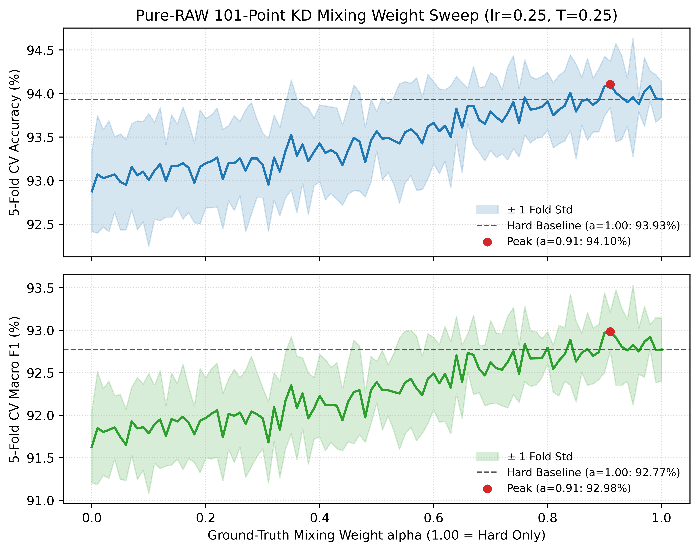

# Fast-XMal: Low-Latency Explainable Android Malware Detection

Official code and artifacts for the paper:

**"Fast-XMal: TreeSHAP-Guided Feature Compression and OOF Knowledge Distillation for Low-Latency Android Malware Detection" (ICCIT 2026).**

---

## 📌 Key Highlights

- **High Predictive Performance:** **94.35% Accuracy** and **93.45% Macro F1** on the untouched 2,320-application holdout set of CICMalDroid 2020.
- **Extreme Model Compactness:** 45 LightGBM trees (45 × 5 = 225 binary trees, depth 4, 15 leaves) packaged into a **369.59 KB** `.txt` artifact (~66× smaller than the 24.48 MB Master Teacher).
- **Dimensionality Reduction:** 87.3% compression (from 474 down to **60 features** via pure-raw global TreeSHAP ranking; 42/60 core features consistent across all 5 folds).
- **Physical Smartphone Deployment:** Standalone single-threaded C inference and TreeSHAP engine benchmarked on a physical **Samsung Galaxy A03 Core** (Android 13, 2 GB RAM):
  - **2.76 ms** pre-extracted prediction + TreeSHAP latency (P99: 2.83 ms, 2.99 MB RSS).
  - **4.44 ms** post-capture detection latency across 1,000 live `ptrace` repetitions (P99: 4.76 ms).
  - **622k–784k syscalls/s** flash log parsing throughput under ≤1.96 MB RSS.
  - Verified numerical parity (≤3.553 × 10⁻¹⁵ SHAP error) and raw-score additivity (≤7.105 × 10⁻¹⁵).
- **Empirical Balancing Audit:** Rigorous evaluation of conditional CTGAN and SMOTE-ENN balancing against pure-raw training, demonstrating why pure-raw training was selected for the final pipeline.

---

### 📈 Temperature-Sharpened OOF-KD Alpha Sensitivity

The 101-point parametric grid search ($\alpha \in [0.00, 1.00]$, step = $0.01$, with $T=0.25$) on development 5-fold cross-validation identifies $\alpha = 0.90$ as a stable operating point (94.08% accuracy, 92.97% Macro F1):

<p align="center">
  
</p>

---

## 📂 Repository Structure

```text
├── android_c/                         # Standalone C inference engine & physical Android benchmarks
│   ├── v7_model_data.h                # Exported 225-tree model header (6,173 nodes)
│   ├── fast_xmal_android_bench.c      # 2,320-row parity & tight-loop benchmark
│   ├── fast_xmal_v7_ptrace_1000.c     # 1,000-repetition live ptrace tracing engine
│   ├── fast_xmal_v7_log_1000.c        # 1,000-round flash log parsing benchmark
│   ├── fast_xmal_v7_test_23masked.c   # On-device 23-Binder zero-masking test
│   └── benign_app_session_v7.c        # Multi-threaded, multi-process Android session
├── configs/                           # Feature maps and partition schemas
│   ├── feature_groups.json             # 4 composite domain definitions
│   ├── top60_features.json             # 60 selected features + SHAP importances
│   └── kernel_binder_partition.json   # 37 kernel vs. 23 Binder features
├── data/                              # Split-first partition indices (Zero Leakage)
│   ├── dev_indices.npy                 # 9,278 development row IDs
│   ├── holdout_indices.npy             # 2,320 untouched holdout row IDs
│   └── v7_outer_folds_indices.npz      # Canonical 5-fold CV splits
├── experiments/                       # Python replication scripts
│   ├── eval_holdout.py                 # Reproduces Table IV/V (94.35% Acc in ~2s)
│   ├── eval_masking.py                 # Reproduces Table VI (0-20% & 23-Binder masking)
│   └── audit_duplicates.py             # Reproduces duplicate vector audit (Sec. VI-H)
└── models/                            # Pre-trained frozen model artifacts
    ├── v7_fast_xmal_student.txt        # 369.59 KB native LightGBM text model
    └── v7_fast_xmal_student.joblib     # 371 KB joblib model
|__ figures/                            # all important figures
```

---

## 🚀 Quickstart & Replication

### 1. Environment Setup

```bash
git clone https://github.com/Nowfel6/Fast-XMal.git
cd Fast-XMal
pip install -r requirements.txt
```

### 2. Dataset Placement

Download `feature_vectors_syscallsbinders_frequency_5_Cat.csv` from the [CICMalDroid 2020 repository](https://www.unb.ca/cic/datasets/maldroid-2020.html) and place it inside the `data/` directory.

### 3. Reproduce Paper Results (Instant Evaluation)

- **Table IV (Holdout Performance & Confusion Matrix):**

  ```bash
  python experiments/eval_holdout.py
  # Output: Accuracy: 94.35% | Macro F1: 93.45%
  ```

- **Table VI (Stochastic & Structured 23-Binder Zero-Masking):**

  ```bash
  python experiments/eval_masking.py
  # Output: Clean: 94.35% | 23-Binder Masked (37-D): 79.27% (1,839/2,320)
  ```

- **Section VI-H (Duplicate Vector Sensitivity Audit):**

  ```bash
  python experiments/audit_duplicates.py
  # Output: 20 duplicate vectors identified; excluding them yields 94.39% (+0.04 pp)
  ```

---

## 📱 Physical Android Deployment (Samsung Galaxy A03 Core)

All benchmarks are natively compiled with `clang -O3` inside Termux on Android 13:

```bash
cd android_c

# 1. Verify 2,320-row numerical parity & pre-extracted latency
clang -O3 -Wall -Wextra fast_xmal_android_bench.c -lm -o fast_xmal_android_v7
./fast_xmal_android_v7 holdout_2320_top60_with_ref.csv py_shap_ref_200.csv

# 2. Compile and run 1,000-repetition live ptrace interception
clang -O2 -pthread benign_app_session_v7.c -o benign_app_session_v7
clang -O3 -Wall -Wextra fast_xmal_v7_ptrace_1000.c -lm -o fast_xmal_v7_ptrace_1000
./fast_xmal_v7_ptrace_1000 1000

# 3. Compile and run 1,000-round flash log parsing benchmark
clang -O3 -Wall -Wextra fast_xmal_v7_log_1000.c -lm -o fast_xmal_v7_log_1000
./fast_xmal_v7_log_1000
```

---

## 📄 Citation

If you find this work helpful, please cite our ICCIT 2026 paper:

```bibtex
@inproceedings{nowfel2026fastxmal,
  author    = {Nowfel, Md. Showaib and Chowdhury, Mahfuzulhoq and Zubaer, Imam Abu},
  title     = {Fast-{XMal}: {TreeSHAP}-Guided Feature Compression and {OOF} Knowledge Distillation for Low-Latency {Android} Malware Detection},
  booktitle = {Proceedings of the 2026 29th International Conference on Computer and Information Technology (ICCIT)},
  year      = {2026}
}
```
